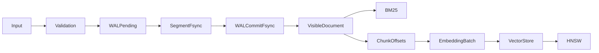
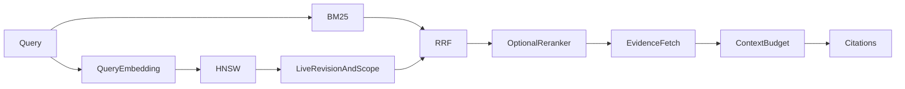
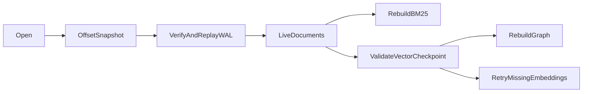
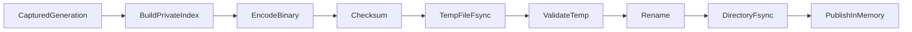
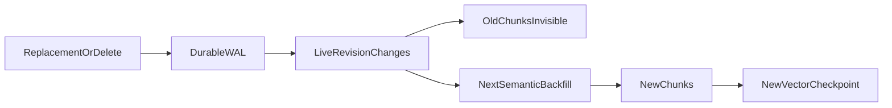

# Hybrid retrieval architecture

## Existing engine audit

Shardly is an append-only JSON document store. `Storage` owns a process lock, segment file descriptors, the offset map, and WAL. A write fsyncs a checksummed pending WAL record, appends and fsyncs document bytes, fsyncs a committed WAL record, then updates the offset map and storage version. Batch writes share fsyncs but are not atomic transactions. A complete pending record can be recovered even without acknowledgement. Deletes fsync a WAL tombstone before hiding a document. `Engine.ingestDocuments` replaces by source identity and hashes canonical document content for revisions. Ordinary insertion creates a new UUID.

The offset snapshot stores physical offsets, checksums and storage version. Recovery verifies referenced segment records, replays WAL in order, publishes an offset snapshot, and clears WAL. Compaction copies live records into new segments and atomically publishes offsets before reclaiming old files. Before this extension, checkpoints did not carry individual WAL sequence numbers. A crash between offset publication and WAL truncation could advance the generation again during replay. New log records now carry a monotonic sequence, and offset snapshots carry a WAL watermark so covered records are skipped on recovery. Legacy records remain readable. Storage version remains the retrieval generation and is distinct from the WAL sequence.

`InvertedIndexStore` uses packed typed postings and positional tokens. `Engine` maintains source identity, revisions and metadata separately from full document reads, with a bounded document cache. The tokenizer retains original UTF-16 offsets, English stemming, stopwords and identifier expansion, and uses Intl segmentation for other languages. BM25 supports field windows, phrases and scoped filters. Its checksummed JSON snapshot is derived and rebuilt when incompatible. These scoring and tokenizer semantics stay unchanged.

`RuntimeEngine` accepts both the synchronous engine and its worker proxy. The server uses one storage worker, bounded to 32 outstanding calls. Writes serialize; reads may observe committed batch prefixes at worker yields. The existing API includes ingestion, lexical retrieval, evidence references, read scopes, source synchronization and backups. Semantic retrieval previously used JSON arrays and exact scan, with HTTP embedding and reranking providers. `Retrieval` already provides RRF, fallback and generation checks. Existing tests and crash scripts remain authoritative regression checks. Existing SciFact evaluation covers BM25 only.

## Extension boundaries

Document bytes and versions remain authoritative. Chunks store parent ID, revision, field and original offsets; content is fetched from the document store. Vector snapshots store Float32 coordinates in binary and model identity with a checksum. HNSW is derived from those vectors. A missing graph can be rebuilt without inference. A missing vector checkpoint requires the same model assets or externally supplied embeddings again. Externally supplied embeddings must be retained durably by the caller or in original documents. An acknowledged document commit does not acknowledge semantic indexing.

## Consistency and ownership

Search validates semantic candidates against current authorized document revisions. Filtering never exposes inaccessible candidates. ANN traversal can pass through excluded nodes; filtering candidates after traversal can reduce recall. Selective filters use exact prefiltered search. Retrieval checks the document generation again before returning evidence and discards results if it changed. Embedding failures leave document storage and the prior checkpoint intact. Backfill retries reuse matching model-input hashes. Index publication is single-owner; searches use the prior complete snapshot until publication.

Semantic completeness means the checkpoint generation equals the current document generation. Backfill captures a generation and refuses publication if it changes. Restart does not infer completeness from vector count. Inference is optional and runs in a worker for the local provider; HTTP providers retain compatibility. Mutable HNSW construction is single-owner and yields between bounded batches. Large construction and checkpoint encoding can still consume CPU on the caller thread; measure before moving those operations into another worker.

## Validation and continuation

See [HYBRID_STATUS.md](HYBRID_STATUS.md) for measured checks, phase status and outstanding acceptance criteria. Benchmark reports distinguish synthetic mock embeddings from learned semantic models. No ranking improvement is assumed.
